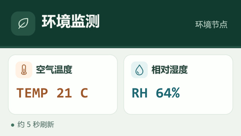

# VGUS 串口屏环境监测首页

本文记录首次自定义双卡片页面。现用版本为 [VGUS 六项环境总览](31-VGUS-Environment-Dashboard.md)。

2026-11-15 实物验证通过。VTc 480×272 串口屏上电进入「环境监测」，先显示温湿度占位，STM32 采集后通过 USART1 更新两项读数。

## 在 VGUS2026 中复现

1. 复制一份厂家的 VTc 480×272 官方测试工程。用 VGUS2026 打开副本里的 `VTc_480272.vt`。该版本已验证可以打开资源树和导入图片。此前在本机用 VGUS Next 单击资源树会挂起。 [厂家工具与测试工程](https://www.viewtech.cn/down/show.php?id=397&lang=cn)
2. 在左侧「图片文件」节点右键选「添加」，导入 [200 号底图（480×272、24 位 BMP）](assets/vgus-home/200_environment_home.bmp)。打开图片 200，在「显示控件 → 文本变量」里创建两个控件。 [厂家控件说明，第 4.1.2 节](https://www.viewtech.cn/UploadFile/EditorFiles/VGUS-DevelopmentGuide.pdf)
3. 按下表填写控件属性。两个控件的字符间距和行间距均为 0，`FONT1 ID` 为「无」，`FONT1 编码方式` 为 GBK。实测工程使用默认红色点阵文字。
4. 在「工具 → 屏参配置」设置开机页 **200**，启用变量属性设置的初始值，核对 **115200、A5 5A、CRC16 关闭、TTL/CMOS**。点击确定，保存后按 F7 生成配置。工程中的 `CONFIG.txt` 应出现 `RE=C8;`，即十进制 200。 [厂家开机页说明](https://www.viewtech.cn/UploadFile/EditorFiles/AppNote38.pdf)

| 控件属性 | 温度 | 相对湿度 |
|---|---|---|
| 左上角坐标 | (32, 163) | (262, 163) |
| 宽 × 高 | 180 × 42 | 180 × 42 |
| 变量存储地址（十六进制字地址） | `0200` | `0240` |
| 字长度 | 8 | 8 |
| FONT0 ID / Y 方向点阵数 | 0 / 32 | 0 / 32 |
| 初始值 | `TEMP --` 后接 9 个 ASCII 空格 | `RH --` 后接 11 个 ASCII 空格 |

官方演示页在相同地址设置过网址和 GBK 字符串。留空会读到已有演示初值，短文本只覆盖开头。因此新控件按 8 字也就是 16 字节补齐空格，覆盖控件可读范围。重新生成后可检查 `VT_SET/22.BIN`，两段 16 字节从文件偏移 `0x0400` 和 `0x0480` 开始。下载到 VTc 屏用的是 `VT_SET_VTc/VTc_Project.bin`。

## 下载和验证

1. 将新生成的 `VT_SET_VTc` 文件夹复制到 FAT32 TF 卡根目录。屏幕断电插卡，重新上电等待下载完成，然后断电拔卡。 [厂家脱机下载说明](https://www.viewtech.cn/UploadFile/EditorFiles/AppNote50.pdf)
2. 只给屏上电，确认进入 200 号首页，两个读数区分别显示 `TEMP --`、`RH --`。
3. 断电接线，STM32 的 USART1 TX（PA9）接屏 DIN，两端 GND 共地。沿用现有固件的 115200 8N1。上电后确认占位被当前读数替换，温湿度与 OLED 随采集更新。 [STM32 串口协议与接线](29-VGUS-Temp-Humi.md)

编译后已检查 VTc 下载包内的开机页与两个初值。用户实测确认绿色开机页、读数显示及最终的开机占位均正常。本次归档包含自制底图、设计预览和复现说明。工程副本与包含官方演示资源的完整下载包留作本地验证。
