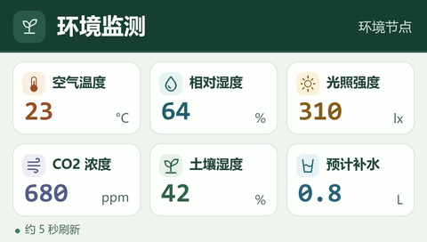

# VGUS 六项环境总览

本文记录旧版首页位于第 0 页时的配置。当前工程加了开机动画，动画结束后第 13 页显示环境读数。 [当前开机流程与页号](37-VGUS-Boot-Animation-and-Link-Status.md)

本文记录六项环境总览的首次验收。现用同一工程已扩展为双页。 [现行双页配置与下载说明](32-VGUS-Actuator-Status.md)

2026-11-16 用户确认实屏复验通过。VTc 480×272 屏上电进入第 0 页，显示空气温度、相对湿度、光照、CO₂、土壤湿度和预计补水。

## 组态和下载

1. 用 VGUS2026 打开 [SmartGrow-VTc 工程](../vgus/SmartGrow-VTc/SmartGrow-VTc.vt)。工程只包含自制底图和同一个页面上的六个文本变量。旧的双卡片工程见[首次首页记录](30-VGUS-Environment-Home.md)。
2. 确认开机页为 0，串口使用 TTL/CMOS、115200、帧头 `A5 5A`、CRC16 关闭。启动时启用变量属性里的初值，每格填 `--` 后接 14 个 ASCII 空格。
3. 按 F7 生成配置。将生成的 `VT_SET_VTc` 文件夹复制到 FAT32 TF 卡根目录。屏断电插卡，上电等待下载完成，断电拔卡后重新上电。仓库保存工程源文件和素材，本次下载包保存在本地。
4. 烧录配套 STM32 固件，断电接线。PA9（USART1 TX）接屏 DIN，两端 GND 共地。屏通过串口接收读数，约每 5 秒更新一次。

## 数据和地址

| 字地址 | 项目 | 显示举例 | 数据来源 |
|---|---|---|---|
| `0x0200` | 空气温度 | `23` °C | 当前温度 |
| `0x0240` | 相对湿度 | `64` % | 当前相对湿度 |
| `0x0280` | 光照强度 | `310` lx | 光照 ADC 换算值 |
| `0x0288` | CO₂ 浓度 | `680` ppm | JW01 读数 |
| `0x0290` | 土壤湿度 | `42` % | 土壤 ADC 换算值 |
| `0x0298` | 预计补水 | `0.4` L | 当前灌溉业务保存的估算量 |

中文和单位固定在底图中，USART1 使用 115200、8N1。固件为每项发送一条 `0x82` 写变量帧，完整覆盖 8 个字。文本是 ASCII，补齐到整字后写 `FF FF`，其余字节填空格。若读数缩短或变为 `--`，整槽写入可清除原来的尾部。未来更换主控时按这张表和帧格式发送即可继续使用这套屏幕工程。

主循环在周期采集和灌溉控制更新后发送一份快照。温度、湿度、CO₂ 依据现有有效位显示，读取失败时用 `--`。光照和土壤湿度按当次采集服务提供的数值显示。补水卡片和 OLED 共用业务估算值并保留一位小数。停泵后可能显示上一次估算量。

## 验证记录

- VGUS2026 编译成功，核对了开机页、底图、32 点阵 ASCII 字库以及六个文本变量的坐标、地址、长度和初值。
- Keil 完整重编译为 0 错误、5 条既有 cJSON 警告。
- 13 套固件主机回归通过。1542 帧 USART1 专项检查覆盖有效位、边界读数、文本尾部清理及单帧发送失败后继续发送其余项。
- 用户确认本轮实屏复验通过。
